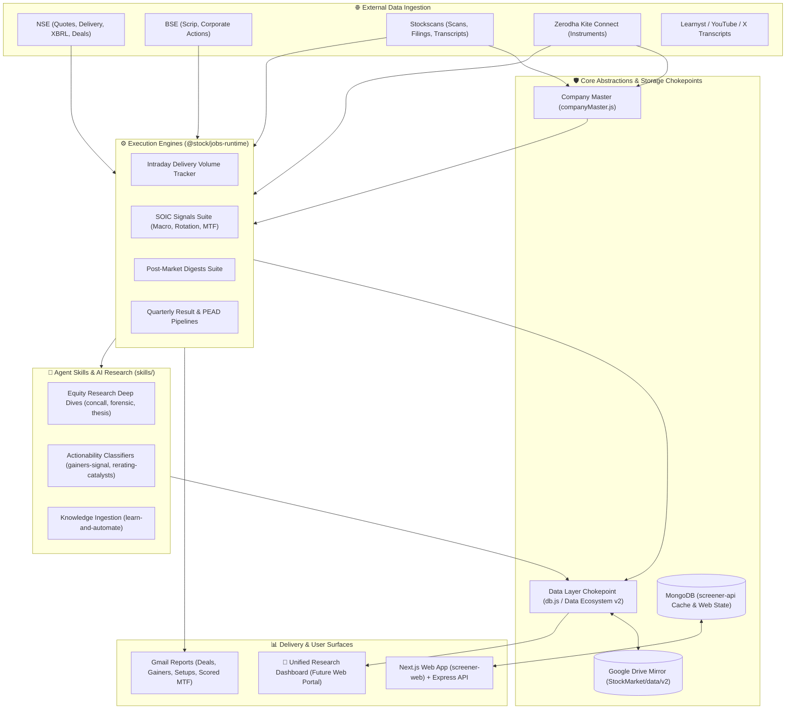

# Setup

1. Jobs folder is linked as cowork root folder.
2. .env at root has all the secrets
3. Google drive is used as database.
4. All skills are stored in github & orchestrated via a single registry skill

# 📈 Stock Market AI Ecosystem

A full-stack, **platform-agnostic AI ecosystem** built for institutional-grade Indian equity research, real-time screening, multi-tiered catalyst detection, and automated portfolio tracking.

> **Our Ultimate Engine**: Learn from Market & Filings ➔ Ingest & Preprocess ➔ Deterministic Signals & AI Thesis Extraction ➔ Signal Ledger & Outcome Tracking ➔ Multi-Channel Digest Reporting.

---

## 🏛️ Ecosystem Architecture & Interaction Flow

The monorepo operates on a modular, multi-tier pipeline where external data feeds, background scheduled jobs, agent skills, and full-stack web applications interact seamlessly through shared chokepoints:



### How the Components Interact:

1. **The Workspace Facade (`package.json`)**: All scripts and background jobs are invoked strictly through `yarn <script>` commands at the root or workspace level—never through raw `node` paths.
2. **Deterministic Scripts vs. AI Judgment**: All data ingestion, ratio calculations, exchange scraping, deduplication, and file generation are handled 100% deterministically by Node.js scripts in `packages/jobs-runtime/`. LLM models (`flash_lite`, `flash`, `pro`) are called only for high-leverage qualitative extraction, sentiment analysis, and investment thesis cards.
3. **Canonical Data Chokepoints**:
   - `packages/jobs-runtime/lib/companyMaster.js`: Resolves tickers/scrips to a canonical `EXCH:SYMBOL` identity.
   - `packages/jobs-runtime/lib/db.js`: The **single chokepoint** authorized to persist files under `data/` and manage JSON collections (`events`, `signal-ledger`, `companies`).
4. **Output DTO Standard**: Every job outputs a structured, reproducible JSON DTO before any HTML email is composed or PDF is rendered, preventing analytical drift.

---

## ⏰ Scheduled Cron Jobs Timeline

All daily micro-jobs have been consolidated into cohesive pipelines organized by market hours, execution dependencies, and cognitive tiers:

```
09:00       10:25               16:00       18:30    19:00    19:15    19:30    20:30        21:15    23:45       01:00
  │           │                   │           │        │        │        │        │            │        │           │
  │     [MARKET HOURS]            │           │        │        │        │        │            │        │     [OFF-HOURS]
  │           │                   │           │        │        │        │        │            │        │           │
  ▼           ▼                   ▼           ▼        ▼        ▼        ▼        ▼            ▼        ▼           ▼
Sunday     Intraday           (Intraday    Weekly    SOIC     SOIC      MTF     Post-Market   Daily    Post-Close  Drive Sync
Code Audit Hourly Volumes     Closes at    Policy    Macro    Setups    Flush   Digests       Results  Recap       & Backup
(Weekly)   (10:25 to 17:25)   17:25)       Events    Sweep    Rotation  Suite   Suite         Analysis Cards       (Nightly)
```

### Comprehensive Cron Job Schedule

| Slot / Timing                                  | Job Name / Workspace Facade                                                 | Model Tier                        | Purpose & Execution Flow                                                                                                                                                                                                                                                                                                                                                                                  | Output / Notifications                                                 |
| :--------------------------------------------- | :-------------------------------------------------------------------------- | :-------------------------------- | :-------------------------------------------------------------------------------------------------------------------------------------------------------------------------------------------------------------------------------------------------------------------------------------------------------------------------------------------------------------------------------------------------------- | :--------------------------------------------------------------------- |
| **`25 10-17 * * 1-5`**<br>(Hourly 10:25–17:25) | `delivery-volume-tracker`<br>`yarn delivery-volume-snapshot-then-report`    | `flash_lite`<br>(Low)             | Captures live intraday traded vs. delivery volumes across Darshan's portfolio watchlist. Tracks accumulation vs. algo churn.                                                                                                                                                                                                                                                                              | Hourly cumulative email table with volume ratios and settlement flags. |
| **`45 18 * * 1-5`**<br>(18:45 IST)             | `daily-gainers-signal`<br>`yarn gainers-signal`                             | `flash`<br>(Medium)               | Screens top 50 market gainers, filters for delivery value & mcap, classifies actionability (ACT/WATCH/NOTED), and generates J-Curve thesis cards.                                                                                                                                                                                                                                                         | Daily Gainers Actionability email with direct PDF thesis cards.        |
| **`0 19 * * 1-5`**<br>(19:00 IST)              | `soic-macro-structural-daily`<br>`yarn soic-macro-structural-daily`         | `flash_lite`<br>(Low)             | Top-down macro & structural supply sweep:<br>1. Nifty 500 breadth, Brent, US10Y, USDINR, FII/DII (`M1-M4`)<br>2. Block-deal supply spikes & FII outflow (`L1-L2`)<br>3. Paper supply & QIP watch in P/E>50 names (`V2`)<br>4. IPO lock-in expiries & OFS filings<br>5. Policy price absorption vs. CNX500 (`P1`)                                                                                          | Unified Signal Ledger email (sent only on state changes/transitions).  |
| **`15 19 * * 1-5`**<br>(19:15 IST)             | `soic-setups-rotation-daily`<br>`yarn soic-setups-rotation-daily`           | `flash_lite`<br>(Low)             | Bottom-up technical setups, breadth clusters & exits:<br>1. RS $\ge 90$ base-breakout (E1) & pullback (E2) setups<br>2. Near-high industry concentration (`S1`)<br>3. Sector rotation & relative strength (`S2-S3`)<br>4. SOIC valuation stretch flags (`V1`)<br>5. Trailing watchlist exit alerts (`X1-X7`)<br>6. QoQ earnings gap lists                                                                 | Unified Signal Ledger email (sent only on state changes/transitions).  |
| **`30 19 * * 1-5`**<br>(19:30 IST)             | `mtf-flush-suite-daily`<br>`yarn mtf-flush-suite-daily`                     | `flash_lite`<br>(Low)             | Shashank's Margin Trading Facility (MTF) Rule G4 trading lifecycle:<br>1. Scans today's new MTF flush entries & scores 0–100 (Tier A/B/C)<br>2. 7-day price recovery check vs. 20/50 EMA<br>3. Tracks realised 5/10/20-day returns of mature signals                                                                                                                                                      | Scored MTF entry alert email + per-signal recovery verdicts.           |
| **`30 20 * * 1-5`**<br>(20:30 IST)             | `post-market-digests-suite`<br>`yarn post-market-digests-suite`             | `flash_lite`<br>(Low)             | Post-market data consolidation & activity digests:<br>1. Watchlist Sync (Near Highs, Upcoming Results, RS)<br>2. Company Master Sync (Kite Connect + Stockscans reconciliation)<br>3. Daily Deals Digest (Bulk, Block, SAST Reg 29, Insider PIT)<br>4. Daily Gainers Digest (Top gainers by sector with streaks)<br>5. Near Highs Digest (Stocks within 5% of 52W high)<br>6. Idempotent `yarn data:push` | **Individual HTML emails** for Deals, Gainers, and Near Highs digests. |
| **`15 21 * * 1-5`**<br>(21:15 IST)             | `daily-quarterly-result-analysis`<br>`yarn daily-quarterly-result-analysis` | `gemini-3.8-flash-high`<br>(High) | Flagship earnings analysis: analyzes quarterly PPTs, results filings, and concall transcripts. Extracts rate of change ($\Delta$), margins, guidance commitments, and sentiment inflections.                                                                                                                                                                                                              | Institutional Results Analysis report + structured events record.      |
| **`45 23 * * 1-5`**<br>(23:45 IST)             | `post-close-day-recap`<br>`yarn post-close-day-recap`                       | `flash_lite`<br>(Low)             | End-of-day announcement recap: re-ranks all thesis cards from the day's corporate filings against settled NSE delivery percentages and closing price returns.                                                                                                                                                                                                                                             | Consolidated Day Recap email with settled market data.                 |
| **`0 1 * * *`**<br>(Nightly 01:00 IST)         | `upload-stock-reports-to-google-drive`<br>`yarn data:sync`                  | `flash_lite`<br>(Low)             | Off-hours maintenance: prunes old checkpoint caches, audits stray files, and performs bidirectional mirror sync with Google Drive (`StockMarket/data/v2`).                                                                                                                                                                                                                                                | Execution log & sync status report.                                    |
| **`0 9 * * 0`**<br>(Sundays 09:00 IST)         | `periodic-dead-code-scan`<br>`yarn dead-code:scan`                          | `flash`<br>(Medium)               | Static codebase analysis: audits monorepo for unreferenced files, orphaned exports, dead dependencies, and coding standard violations. Updates `data/tasks.json`.                                                                                                                                                                                                                                         | Markdown action plan at `DEAD_CODE_ACTION_ITEMS.md`.                   |
| **`30 18 * * 0`**<br>(Sundays 18:30 IST)       | `policy-event-tracker`<br>`yarn policy-events add`                          | `flash_lite`<br>(Low)             | Scans RBI press releases, SEBI RSS, and PIB cabinet decisions. Identifies fresh government policies and maps them to 3–25 ticker sector proxy baskets for the upcoming week.                                                                                                                                                                                                                              | Weekly policy absorption email table with official source links.       |
| **`0 20 * * 0`**<br>(Sundays 20:00 IST)        | `weekly-gainers-digest`<br>`yarn weekly-gainers-digest`                     | `flash_lite`<br>(Low)             | Weekly top gainers across all industries with multi-week persistence scoring and sector concentration analysis.                                                                                                                                                                                                                                                                                           | Weekly Gainers Digest email.                                           |

---

## 🔮 Future Vision: The Unified Research & Signal Dashboard

While today's notifications are broadcast via automated Gmail HTML reports, the entire backend is architected around **structured, schema-validated JSON DTOs stored in flat collections** (`data/events/`, `data/signal-ledger/`, `data/runs/`).

This architecture makes it straightforward to replace or complement email alerts with a **modern, centralized Next.js Web Dashboard**:

```
┌───────────────────────────────────────────────────────────────────────────────────────┐
│                        STOCK SCREENER & SIGNAL PORTAL (VISION)                        │
├────────────────────────────────┬──────────────────────────────────────────────────────┤
│ 📊 MARKET REGIME BANNER        │ Breadth: 64% > 50 DMA · Macro: Neutral · FII: Net Buy │
├────────────────────────────────┴──────────────────────────────────────────────────────┤
│ 🔔 LIVE SIGNAL LEDGER FEED     │ 🚀 E1 Breakout: DATAPATTNS · ⚠️ X2 Loss: TATACHEM    │
├────────────────────────────────┬──────────────────────────────────────────────────────┤
│ 📑 DAILY INTELLIGENCE REPORTS  │ 📦 INTRADAY DELIVERY FLOWS                           │
│  • Deals Digest (Bulk/SAST)    │   Track portfolio accumulation % in real-time        │
│  • Top Gainers & J-Curves      ├──────────────────────────────────────────────────────┤
│  • Earnings Concall Analysis   │ 🎯 MTF FLUSH WATCHLIST                               │
│  • Policy Event Proxy Baskets  │   View Tier-A flush rebounds & outcome stats         │
└────────────────────────────────┴──────────────────────────────────────────────────────┘
```

- **Zero Email Clutter**: View interactive daily digests, historical trends, and signal transitions directly in the browser with dark mode and multi-tab layouts.
- **Instant PDF & Briefing Access**: One-click viewing of generated Puppeteer equity research PDFs, concall tear-sheets, and thesis cards.
- **Interactive Signal Replay**: Backtest and inspect historical SOIC signals (`M1-M4`, `S1-S4`, `E1-E2`, `G4`, `P1`) with live price overlays.

---

## 💻 Core Features

- 🔍 **Stock Search**: Fast auto-complete search across 500+ stocks
- 📊 **Advanced Screener**: Filter stocks with 15+ fundamental and technical criteria
- 📈 **Price Charts**: Interactive 5-year price charts with SMA overlays
- 📋 **Watchlist**: Track your favorite stocks with real-time price updates
- 🏢 **Corporate Announcements**: Scan and analyze corporate announcements and documents
- 🚀 **Top Gainers**: Track daily top gainers live
- 🤖 **Automated Insights**: AI-powered insight validation and generation for watchlists
- 🔄 **Data Pipelines**: Robust jobs for syncing and offloading data from real sources (NSE, BSE, Stockscans)
- 💹 **Technical Indicators**: RSI, MACD, SMA50, SMA200 calculations
- 📑 **Financial Statements**: View P&L and Balance Sheets for last 4 quarters
- 🎯 **Pre-built Screeners**: Value, Growth, Dividend, Quality stock templates
- 📤 **CSV Export**: Export screener results to CSV

## Tech Stack

### `screener-api` (Express API)

- **Node.js** + **Express.js** - REST API
- **MongoDB** + **Mongoose** - Database for the web app's own screener/watchlist/stock-cache data
- **Axios** - External API calls
- **Joi** - Input validation

### `screener-web` (Next.js frontend)

- **Next.js 14** - React framework
- **React 18** - UI library
- **Tailwind CSS** - Styling
- **Recharts** - Data visualization
- **Axios** - API client

### Skills & jobs (the bulk of the repo's value today)

- **`skills/`** - 79+ Agent Skills for Indian equity research (concall
  analysis, forensic accounting, DRHP/IPO analysis, quarterly-result
  analysis, etc.) — run via Claude Code/Cowork and Google Antigravity. See
  `skills/README.md`.
- **`packages/jobs-runtime/`** - Shared execution runtime, deterministic scrapers,
  and data access chokepoints (`lib/db.js`, `lib/companyMaster.js`).
- **`jobs/Scheduled/`** - Scheduled automation jobs (digests, trackers,
  scanners) that delegate to `packages/jobs-runtime/`.
- **Data Ecosystem v2** - Flat JSON collections under `data/`, accessed only
  through `packages/jobs-runtime/lib/db.js`, mirrored to Google Drive. See
  `docs/DATA_ECOSYSTEM.md` and `docs/DATA_RULES.md`. This is separate from
  the MongoDB layer above — MongoDB backs `screener-api`'s own transactional
  features (screener runs, watchlist), while the Data Ecosystem backs
  research/skills data.

## Project Structure

```
stockmarket/
├── package.json          # Yarn 3 workspaces root (yarn install, yarn dev)
├── yarn.lock             # Pinned dependency tree (commit this file)
├── .yarnrc.yml            # Yarn Berry settings (node_modules linker)
├── screener-api/          # Express REST API (workspace: screener-api)
│   ├── src/core/          # config (Mongo), shared api clients, middleware, utils
│   ├── src/features/      # one folder per feature: stock, screener, watchlist,
│   │                       # market, orders, announcements, results, admin, twitter, research
│   │   └── .../*Routes.js, *Controller.js, and Mongoose models (e.g. stock/Stock.js)
│   ├── scripts/           # data-fetch scripts (fetchData.js, etc.)
│   └── src/server.js      # Express entry point
├── screener-web/          # Next.js 14 frontend (workspace: screener-web)
│   ├── pages/              # Next.js pages
│   ├── src/core/           # shared components, API client (lib/api.js), hooks
│   └── src/features/       # dashboard, screener, results, stock feature components
├── stock-api/             # shared external-API clients (Stockscans/NSE/BSE) + skill CLI entry points
├── cloud-utils/           # Google Drive/Gmail integration shared across workspaces
├── packages/jobs-runtime/ # shared data/env/job-scheduling runtime (db.js is the only writer to data/)
├── jobs/                  # scheduled-task definitions (delegate to packages/jobs-runtime)
├── skills/                # Claude Agent Skills (equity research, tooling, dev) — see skills/README.md
├── data/                  # flat JSON collections ("Data Ecosystem v2") — gitignored, see docs/DATA_ECOSYSTEM.md
├── docs/                  # Documentation
└── README.md
```

## Getting Started

### Prerequisites

- Node.js 18+ (includes [Corepack](https://nodejs.org/api/corepack.html) for the pinned Yarn version)
- MongoDB installed and running
- Terminal

Enable Corepack once per machine (lets the repo use Yarn 3 via the `packageManager` field in `package.json`):

```bash
corepack enable
```

### Installation

#### 1. Clone the repository and install dependencies

```bash
cd stockmarket
yarn setup
```

`yarn setup` = `yarn install` (every dependency for the root package and all workspaces:
`screener-api`, `screener-web`, `stock-api`, `jobs`, `cloud-utils`, `packages/jobs-runtime`)
plus `yarn x-capture:install-host`, which registers the X-capture Chrome extension's native host
(`com.stockmarket.x_kb`) so the extension can write into this repo's KB. The host step is
best-effort (skipped on CI / unsupported OS; re-run it after moving the repo or changing Node;
`--browser brave|edge|chromium` via `node tools/x-timeline-capture-extension/native-host/install.js`).
Then load the unpacked extension once from `tools/x-timeline-capture-extension` in `chrome://extensions`.

#### 2. Configure environment

There is a single root `.env` (see `.env.example` for the full list of keys —
Mongo URL, port, third-party API keys, Google Drive/skills credentials, etc.),
for example:

```bash
cat >> .env << EOF
MONGO_URL=mongodb://localhost:27017/stock-screener
PORT=5001
EOF
```

**screener-web** — point the app at the API (`screener-web/.env.local`):

```bash
echo "NEXT_PUBLIC_API_URL=http://localhost:5001/api" > screener-web/.env.local
```

#### 3. Seed the database (optional, first run)

```bash
yarn seed
```

#### 4. Run the full stack in development

From the **repository root**:

```bash
yarn dev
```

This starts `screener-api` (nodemon) and `screener-web` (`next dev`) together
via `concurrently`. `screener-api` defaults to port `5001` (auto-picks the
next free port if taken), `screener-web` to `http://localhost:3000`.

To run a single workspace:

```bash
yarn workspace screener-api dev
yarn workspace screener-web dev
```

### Accessing the Application

Open your browser and go to:

- **Frontend**: http://localhost:3000
- **Backend API**: http://localhost:5001/api

## API Endpoints

`screener-api` routes live under `screener-api/src/features/<feature>/`. Key
examples (see `docs/API_REFERENCE.md` for the full reference):

### Stock APIs

- `GET /api/stocks/search?q={query}` - Search stocks
- `GET /api/stocks/:symbol` - Get stock details
- `GET /api/stocks/:symbol/technicals` - Get technical indicators
- `GET /api/stocks/:symbol/financials` - Get financial statements

### Screener API

- `POST /api/screener/run` - Run stock screener with filters

### Watchlist APIs

- `GET /api/watchlist` - Get all watchlist items
- `POST /api/watchlist/:symbol` - Add stock to watchlist
- `DELETE /api/watchlist/:symbol` - Remove from watchlist

### Market APIs

- `GET /api/market/indices` - Get market indices data
- `GET /api/market/stats` - Get market statistics

## Usage Guide

### Dashboard

- Search for stocks using the search bar
- View market snapshot (Nifty 50, Sensex, sector performance)
- Quick access to watchlist summary
- Launch pre-built screeners

### Screener

- Apply filters: Market Cap, P/E, P/B, ROE, ROCE, Debt/Equity, etc.
- Click "Run Screener" to see results
- Click on any stock row to view details
- Export results to CSV

### Stock Details

- **Overview**: Company information and key metrics
- **Fundamentals**: All financial ratios and metrics
- **Financials**: P&L and Balance Sheet for 4 quarters
- **Chart**: 5-year price chart with SMA50 and SMA200
- **Technicals**: RSI, MACD, and moving averages

### Watchlist

- Add stocks from screener or stock details page
- View real-time prices and changes
- Remove stocks with one click
- **Insights**: AI-powered insight validation and summaries for watched stocks

### Corporate Announcements & Scans

- Scan through official corporate announcements
- Live tracking of Top Gainers
- Dedicated dashboards for detailed document analysis

## Data Management

There are two separate data layers in this repo — don't confuse them:

1. **MongoDB** — backs `screener-api`'s own screener/watchlist/stock-cache
   features (the web app you run with `yarn dev`).
2. **Data Ecosystem v2** — flat JSON collections under `data/`, used by
   `skills/` and `jobs/`, accessed only through
   `packages/jobs-runtime/lib/db.js` and mirrored to Google Drive. See
   `docs/DATA_ECOSYSTEM.md` and `docs/DATA_RULES.md` for the authoritative
   description.

### Initial Data Population (MongoDB / web app)

`screener-api/scripts/fetchData.js` seeds the database with sample Indian
stocks and generates price history, fundamentals, and financial statements:

```bash
yarn seed
```

### Data Ecosystem sync (skills/jobs data)

```bash
yarn data:push        # push local data/ to Google Drive
yarn data:pull        # pull latest from Google Drive
yarn data:sync        # push, then pull, then print status
yarn data:status      # sync status
```

## Available Scripts

### Root (repository)

- `yarn install` — Install all workspace dependencies (uses `yarn.lock`)
- `yarn dev` — `screener-api` + `screener-web` dev servers together (via `concurrently`)
- `yarn build` — Production build of `screener-web`
- `yarn start` — `screener-api` + `screener-web` production servers together
- `yarn seed` — Seed MongoDB via `screener-api/scripts/fetchData.js`
- `yarn test` — Run `screener-api` tests, then `screener-web` tests
- `yarn format` / `yarn format:check` — Prettier across the repo
- `yarn lint` / `yarn lint:fix` — ESLint across the repo
- `yarn quality` — Pre-submit sweep: `rules:check` + `format:check` + `lint` + `test`
- `yarn dead-code:scan` — Scan monorepo for unreferenced files, committed stray artifacts, and coding practice violations
- `yarn dep:tree <target>` — Generate visual dependency tree diagram (HTML, Mermaid, text) for any given variable or file across direct imports, skills, scheduled jobs, and scripts
- `yarn data:push` / `yarn data:pull` / `yarn data:sync` / `yarn data:status` — Data Ecosystem v2 sync with Google Drive (see above)
- `yarn company-master-sync` — Sync and reconcile the company master DB (`cache/company-master.json`) combining Stockscans company universe (sector/industry classifications), Kite instruments dump, and `companies.json` metadata. Scheduled daily at 10 PM.
- `yarn rules:check` / `yarn rules:sync` — verify/fix parity between `AGENTS.md` and the tool-specific rule files (`CLAUDE.md`, `.cursor/rules/*.mdc`, `.gemini/rules/*.md`)

### screener-api (`yarn workspace screener-api <script>`)

- `yarn workspace screener-api start` — Production server
- `yarn workspace screener-api dev` — Development with nodemon
- `yarn workspace screener-api test` — Jest tests

### screener-web (`yarn workspace screener-web <script>`)

- `yarn workspace screener-web dev` — Next.js dev server
- `yarn workspace screener-web build` — Production build
- `yarn workspace screener-web start` — Production server

## Sample Stocks Included

The application comes pre-seeded with 20 major Indian stocks:

- RELIANCE, TCS, HDFCBANK, INFY, ICICIBANK
- HINDUNILVR, ITC, SBIN, BHARTIARTL, KOTAKBANK
- LT, AXISBANK, WIPRO, ASIANPAINT, MARUTI
- SUNPHARMA, TITAN, ULTRACEMCO, BAJFINANCE, NESTLEIND

## Features in Detail

### Screener Filters

- Market Cap (Min/Max)
- Sectors (Multi-select)
- P/E Ratio (Min/Max)
- P/B Ratio (Min/Max)
- ROE % (Min/Max)
- ROCE % (Min/Max)
- Debt/Equity (Max)
- Revenue Growth 3Y (Min %)
- Profit Growth 3Y (Min %)
- Dividend Yield % (Min/Max)
- Current Ratio (Min)

### Pre-built Screeners

1. **Value Stocks**: P/E ≤ 15, P/B ≤ 3, ROE ≥ 15%
2. **Growth Stocks**: Revenue Growth ≥ 15%, Profit Growth ≥ 15%
3. **Dividend Stocks**: Dividend Yield ≥ 2%, P/E ≤ 20
4. **Low Debt**: D/E ≤ 0.5, Current Ratio ≥ 1.5
5. **Quality Stocks**: ROE ≥ 15%, ROCE ≥ 15%, D/E ≤ 1

## Troubleshooting

### MongoDB Connection Error

- Ensure MongoDB is running: `mongod` or `brew services start mongodb-community`
- Check `MONGO_URL` in the root `.env`

### Port Already in Use

- `screener-api` (default 5001): change `PORT` in the root `.env`, or let it auto-pick the next free port
- `screener-web` (3000): `yarn workspace screener-web dev -- -p 3001`

### No Data in Application

- Run the seed script: `yarn seed`

### API Errors

- Check the `screener-api` server is running (port 5001 by default)
- Verify `NEXT_PUBLIC_API_URL` in `screener-web/.env.local`

## Performance Notes

- Initial database seed takes 2-3 minutes
- Screener queries execute in < 3 seconds
- Price charts sample data for optimal rendering
- Watchlist refreshes every 5 minutes

## License

This project is for personal use only.

## Support

For issues or questions, create an issue in the repository.

---

**Built with ❤️ for personal investment analysis**
